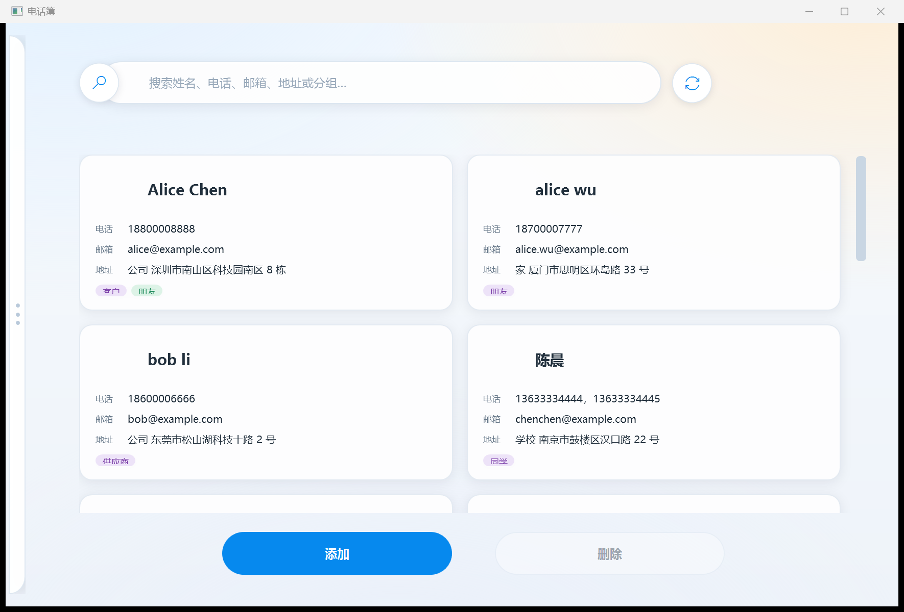

# 电话簿 ContactBook

一个 Windows 单机电话簿桌面应用，使用 **.NET 11 + WPF** 编写。界面按 `conck.png` / `sidebar.png` / `contact_info.png` 三张设计稿实现，背景配色取自参考页 `index.html` 的浅蓝渐变。



## 功能

### 主界面
- 两列联系人卡片，卡片展示头像、电话、邮箱、地址、分组；字段为空时自动隐藏该行。
- 没有头像的联系人使用**透明头像**（卡片上不显示任何图形）。
- 单击卡片选中（蓝色描边），只有选中后「删除」按钮才可用。
- 双击卡片打开联系人面板。
- 底部「添加」新建联系人；「删除」弹出确认框，确认后删除。

### 左侧悬浮侧边栏
- 平时只在窗口左侧露出一条窄边（带三个小圆点），**鼠标移入自动展开**。
- 鼠标离开展开区域 **0.1 秒**后自动收回；期间移回则取消收回。
- 按姓名首字母分组排序；中文姓名按**拼音首字母**分组（如「刘洋」→ L，「张伟」→ Z）。
- 同一字母下，大写开头的名字排在前面（`Alice Chen` 在 `alice wu` 前）。
- 每条显示「名字 + 电话」；一个人有多个电话时会重复出现多行，每行对应一个号码。
- 单击条目在下方列表中选中该联系人，双击打开联系人面板。

### 搜索与筛选
- 圆形放大镜按钮 + 圆角输入框，输入框右侧还有一个圆形刷新按钮。
- 输入后 **300ms** 防抖再执行模糊匹配，匹配结果显示在搜索栏正下方的浮层中（内容超出时自带滚动条）。
- 匹配范围：姓名、电话、邮箱、地址、分组；空格分隔多个关键词时需同时命中，先做子串匹配，再退化为子序列（fzf 式）模糊匹配。
- **按回车**或**点击放大镜**：把匹配结果应用到主列表，界面上只保留匹配成功的联系人（搜索框保留关键词，方便继续修改）。
- **点击右侧刷新按钮**、按 **F5** 或 **Ctrl+R**：清空搜索并重新从磁盘读取数据，恢复显示全部联系人。
- 下拉结果单击可定位到对应卡片，双击直接打开联系人面板。

> 关于 F5：Windows 桌面应用里 F5 没有被系统占用；Linux 下 F5 只是浏览器/文件管理器里的刷新键，不是全局快捷键；macOS 的 F5 默认是键盘背光（新款 Mac 上是听写），所以将来若移植到 Mac 应改用 Cmd+R。因此这里同时支持了 **Ctrl+R** 作为备用组合。

### 联系人面板
- 双击卡片 / 侧边栏条目打开编辑面板；「添加」打开一个空白面板。
- 点击头像选择 **PNG / JPEG** 图片（图片会复制到数据目录）。
- 点击名字文字即可直接输入修改。
- 「电话」「邮箱」「地址」「分组」右侧的 **+** 按钮弹出输入框添加：
  - 地址会弹出两个输入框，第一个是标签（可留空，留空即无标签），第二个是地址内容。
  - 分组只能手动输入，暂不支持从已有分组中选择。
- 标签可通过右侧的 × 移除；「保存」写盘，「取消」放弃修改。

## 运行

双击 `result\ContactBook.exe` 即可。

如果 Windows 弹出「Windows 已保护你的电脑」（SmartScreen），点「更多信息」→「仍要运行」即可——这是没有代码签名的正常提示。

需要 **.NET 11 桌面运行时**（本机随 .NET 11 SDK 已安装）。若要在没有该运行时的电脑上运行，请按下方「发布独立版本」重新打包。

## 数据存放位置

程序启动时会按顺序探测可写目录，使用**第一个真正能写入**的：

1. `%APPDATA%\ContactBook`（标准位置）
2. `%LOCALAPPDATA%\ContactBook`
3. `程序所在目录\data`（便携回退位置）

侧边栏展开后，底部会显示当前实际使用的数据目录，鼠标悬停可看完整路径。

正常情况下数据在：

```
%APPDATA%\ContactBook\contacts.json   联系人数据
%APPDATA%\ContactBook\avatars\        头像图片
```

- 首次运行会自动生成 13 位示例联系人。
- 如果 `%APPDATA%` 因为安全软件、组策略或沙箱限制而不可写，程序会自动落到 `程序所在目录\data`，不会因此崩溃。
- 三个位置都不可写时程序仍可只读运行，保存时会弹出提示而不是闪退。

## 从源码构建

```powershell
# 构建
dotnet build src\ContactBook.csproj

# 直接运行
dotnet run --project src\ContactBook.csproj
```

### 发布到 result

```powershell
dotnet publish src\ContactBook.csproj -c Release -r win-x64 `
  --self-contained false -p:PublishSingleFile=true -o result
```

### 发布独立版本（目标电脑未装 .NET 运行时）

```powershell
dotnet publish src\ContactBook.csproj -c Release -r win-x64 `
  --self-contained true -p:PublishSingleFile=true `
  -p:IncludeNativeLibrariesForSelfExtract=true -o dist
```

## 项目结构

```
ContactBook/
├─ src/                 # WPF 源码
│  ├─ MainWindow.xaml   主窗口
│  ├─ ContactWindow.xaml 联系人面板
│  ├─ InputDialog.xaml  通用输入弹窗
│  ├─ ContactCard.xaml  联系人卡片控件
│  ├─ Models.cs         数据模型与姓名排序
│  ├─ Store.cs          JSON 存储
│  ├─ SearchEngine.cs   模糊搜索
│  └─ Styles.xaml       全局样式
├─ result/              # 可执行文件
├─ docs/                # 截图
└─ README.md
```

## 实现说明

- **拼音首字母**：利用 GB2312 编码按拼音顺序排列汉字的特性，把汉字映射到 A–Z 分组（`CodePagesEncodingProvider`）。非汉字归入 `#`。
- **姓名排序**：先按首字母分组，再在同一组内用 `Ordinal` 比较，正好让大写字母排在相同字母的小写之前。
- **防抖**：`DispatcherTimer` 300ms；侧边栏收回用 100ms 定时器 + 鼠标位置复检。
- **筛选**：回车/放大镜把关键词应用到主列表（结果按匹配得分排序）；刷新按钮与 F5 清空关键词并重新读取磁盘。
- **数据目录探测**：启动时依次对候选目录做一次「写临时文件再删除」的探测，选第一个可写的；侧边栏底部展示结果。
- **存储**：`System.Text.Json`，先写临时文件再替换，避免写入中断损坏数据。

## 已知限制

- 单机应用，没有云同步和导入导出。
- 分组需要手动输入。
- 搜索下拉一次最多显示 40 条结果。
